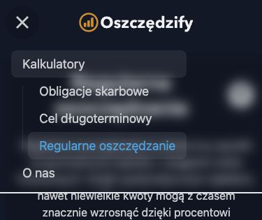

# Etap 9 — publikacja i kontrola produkcji

Data: 22.10.2026. Użytkownik zlecił poprawę kontrastu aktywnej strony w menu mobilnym, a następnie commit wszystkich zmian, push i wdrożenie. Opublikowano etap 9a–9c oraz poprawkę menu. Uwzględniono wcześniejszy commit logo i podglądów społecznościowych `1860192`, obecny już na `origin/main`.

## Opublikowana wersja

- Commit źródeł: `be222d7ca897f55584d55a39c91e857864b7b2d2`, push na `main`. Rebase na aktualnym `origin/main` zachował identyczne źródła aplikacji i Functions.
- Build frontendu: `be222d7-2026-10-22T19:13:19.468Z`, `dirty: false`, API production.
- Build Functions: `be222d7-2026-10-22T19:13:53.660Z`, `dirty: false`.
- Hosting version: `0133aaae92f3b24c`, release `1792696650476000`, 22.10.2026 o **21:17:30 Europe/Warsaw**.
- Oferta `2026-10-v1`, obliczenia v2; ten sam hash konfiguracji oferty w obu buildach.
- Cztery Functions: 2. generacja, `us-central1`, Node 22, 256 MiB. Nazwy i adresy zachowane.

Build produkcyjny ma 8 prerenderowanych tras. Początkowy zestaw zasobów po poprawce menu ma 457,04 kB, poniżej budżetu 500 kB. Opublikowano ten sam artefakt, który przeszedł lokalny smoke Hostingu i kontrolę wszystkich zasobów; nie wykonywano dodatkowego buildu między odbiorem a publikacją.

## Poprawka menu

daisyUI 5 domyślnie wyróżnia link z `aria-current` kolorem neutralnym, który w motywie Oszczędzify jest pomarańczowy. Klasa ograniczona do menu mobilnego ustawia delikatne wyróżnienie na ciemnym tle oraz niebieski tekst `secondary`. Zachowano `aria-current`, rozwijanie sekcji i zamykanie menu po nawigacji. Sprawdzono link kalkulatora i „O nas”, również klawiszem Enter.

## Wyniki kontroli

- Przed publikacją przeszło **35 testów frontendu w 11 zestawach**, **44 testy Functions**, lint obu projektów oraz build obu części. Rebase nie zmienił testowanych źródeł.
- Produkcyjny `smoke:hosting`: siedem stron, H1, metadane, canonicale, Open Graph, JSON-LD, przekierowania 301, rzeczywiste 404, robots i sitemap — OK.
- `version.json` produkcji identyczny z lokalnym artefaktem, poprawny commit i czysty build.
- Wszystkie **47 plików JS/CSS/obrazów/ikon/manifestu** ma HTTP 200 i zawartość identyczną bajtowo z buildem.
- `smoke:api -- --production --contracts`: cztery endpointy, poprawne dane, format błędów HTTP 400, preflight 204 i CORS — OK.
- `smoke:bonds -- --production`: przykłady wykupu, podatek, sześć błędnych żądań i CORS — OK.
- Wszystkie cztery nagłówki `X-Oszczedzify-Build` wskazują nowy build `be222d7`.
- Dodatkowe żądania produkcyjne: ułamkowe lata, okres ponad 100 lat i slug z `../` dają HTTP 400; poprawny nieistniejący artykuł daje 404. Obcy origin nie otrzymuje zgody CORS.
- Przeglądarka na produkcji przy szerokości 390 px potwierdza ciemne wyróżnienie i niebieski tekst aktywnego kalkulatora. Regularne wpłaty 500 zł / 2 lata / 5% dają 12 480,30 zł.
- Nie znaleziono błędów konsoli dotyczących produkcji ani wpisów Cloud Run o poziomie ERROR dla czterech funkcji od rozpoczęcia publikacji. Pojedyncze pomiary odpowiedzi po rozgrzaniu: 169–254 ms; nie są benchmarkiem ani gwarancją czasu odpowiedzi.

## Uwagi operacyjne

Konektor Firebase zaktualizował Functions, lecz oznaczył zadanie jako nieudane na końcowym kroku konfiguracji polityki sprzątania obrazów Artifact Registry. Zwrócił wprost informację o udanym wdrożeniu funkcji. Potwierdzono to stanem ACTIVE, nagłówkami wszystkich czterech funkcji i testami produkcyjnymi. Polityki usuwania obrazów nie zmieniano; komunikat dotyczy utrzymania artefaktów, a nie działania opublikowanej aplikacji.

Próba publikacji Hostingu przez konektor zakończyła się błędem rozpoznawania domyślnej witryny przed wysyłką. Wdrożono przez przypięte CLI `firebase-tools@15.34.1` z jawnymi `--project personal-finance-2ee61 --only hosting`; zakończyło się `Deploy complete`. Konfiguracja `firebase.json` nie wymagała zmiany.

Poprzedni Hosting pozostaje w historii: wersja `eca376453a928c28`, release `1792696001210000`, źródła `1860192` z identyfikacją wizualną. Kod backendu sprzed etapu 9 jest zachowany w historii Git; jego przywrócenie wymaga ponownego wdrożenia na wspieranym Node 22. Nie wykonywano rollbacku ani zmian DNS.

Audyt i wyjątki narzędziowe pozostają opisane w [raporcie etapu 9](ETAP-9-RAPORT.md). Dane publikacji i kontroli: [JSON](baseline/2026-10-22-stage9-deploy.json). Etap 9 jest opublikowany i odebrany. Kolejny zakres planu to etap 10.
