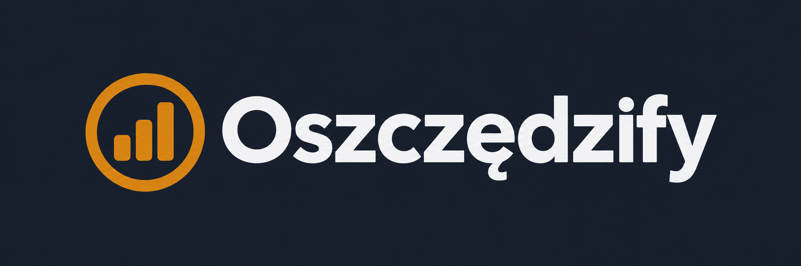

# Oszczędzify — logo i plan użycia

Wersja v1, 22.10.2026. Wybrane logo zostało przygotowane jako SVG i wprowadzone do aplikacji, ikon oraz podglądów udostępnianych linków. Wydanie obejmuje wyłącznie frontend Firebase Hosting. Metadane `/version.json` wskazują dokładny commit opublikowanego artefaktu.

**Wybór użytkownika: trzeci wariant, z najcieńszym okręgiem.** Poniższy obraz jest wybranym wzorcem. Przy przygotowaniu SVG zachować lekki pierścień i proporcje tego wariantu; nie wracać do grubszego okręgu z dwóch wcześniejszych propozycji.

## Idea

Bursztynowe „O” z trzema rosnącymi słupkami oraz jasny napis **Oszczędzify**. Okrąg przywołuje monetę i pierwszą literę nazwy, a stopnie — systematyczne odkładanie pieniędzy. To rozwinięcie motywu słupków z obecnej ikony serwisu. Znak służy identyfikacji marki; nie zastępuje wykresu ani informacji o wynikach symulacji.

Prosta geometria i lekko zaokrąglone słupki pasują do obecnych kart i przycisków. Nazwa zachowuje polskie „ę”. Logotyp powinien mieć przyjazny, mocny krój bezszeryfowy.

Docelowa paleta: bursztyn `#D88A16`, jasny napis `#F1F2F4`, granat prezentacyjny `#171E2B`. W aplikacji tło pozostaje zgodne z istniejącymi zmiennymi motywu. Kolory te są specyfikacją; obraz koncepcyjny może zawierać niewielkie różnice odcieni.

## Rozmieszczenie

Wymiary poniżej dotyczą widocznej grafiki, bez marginesów obrazu koncepcyjnego.

| Miejsce | Wariant i rozmiar | Pozycja i zachowanie |
| --- | --- | --- |
| Nagłówek na komputerze, każda podstrona | SVG o polu 189 × 36 px; widoczny znak około 31 × 31 px | Po lewej, w miejscu poprzedniego tekstowego linku „Oszczędzify”. Nagłówek ma wysokość 64 px. Kliknięcie prowadzi do `/`. Odstęp od nawigacji 24 px. |
| Nagłówek na telefonie | SVG o polu 168 × 32 px; widoczny znak około 27 × 27 px | Wyśrodkowane w nagłówku. Obszar przycisku menu po lewej i równa przestrzeń po prawej rezerwują po 48 px, aby logo nie nachodziło na menu przy szerokości 320 px. Link ma wysokość minimum 44 px. |
| Stopka, każda podstrona | Pełne logo o tych samych rozmiarach co w nagłówku | Wyśrodkowane nad obecnymi linkami „Kalkulatory” i „O nas”. Prowadzi do `/`. |
| Karta przeglądarki | Sam znak, uproszczony dla 16 × 16 i 32 × 32 px | Bez napisu. Przy 16 px pogrubić pierścień i zapewnić czytelne przerwy między słupkami. Ocenić przy rzeczywistej wielkości. |
| Ikona zapisu na ekranie telefonu | Sam znak na pełnym granatowym tle, eksporty 180, 192 i 512 px | Grafika w centralnych około 70% pola; zapas chroni znak przed obcięciem po zaokrągleniu ikony. |
| Podgląd linku udostępnionego w komunikatorze | Pełne logo na grafice 1200 × 630 px, pole logo szerokości 280 px | Lewy górny róg z marginesem 64 px, poniżej tytuł podstrony lub kalkulatora. Siedem osobnych grafik, wspólna pozycja marki; metadane Open Graph i Twitter aktualizują grafikę przy nawigacji. |

Na stronie głównej logo z nagłówka wystarczy. Usunięto powtórzony mały napis „Oszczędzify” nad H1, zachowując tytuł „Kalkulatory finansowe” i opis. Nie dokładamy drugiego dużego logo w sekcji otwierającej.

W kalkulatorach i artykułach identyfikację zapewniają nagłówek i stopka. Nie dodajemy logo przy polach formularzy, przyciskach, tabelach ani wynikach.

## Warianty i zasady

- Podstawowy: bursztynowy znak i jasny napis na ciemnym tle.
- Grubość okręgu: zgodna z trzecim wariantem na załączonym wzorcu. Uproszczenie dla favicony 16 px służy wyłącznie czytelności w małej skali i nie zmienia podstawowego logo.
- Na jasne tło: bursztynowy znak i granatowy napis (`logo-light.svg`).
- Jednokolorowy: opcja na przyszłe materiały; nie jest używana w aplikacji i nie została wyeksportowana.
- Sam znak: ikony przeglądarki i urządzeń. W nagłówku zachowujemy nazwę, aby budować jej rozpoznawalność.
- Pole ochronne: co najmniej 1/4 średnicy znaku z każdej strony. Nie rozciągać, nie obracać, nie dodawać cieni ani animacji wzrostu.
- Link z logo ma dostępne pole interakcji co najmniej 44 × 44 px oraz widoczny fokus. Jego dostępna nazwa: „Oszczędzify — strona główna”. Przy obrazie jako jedynej zawartości linku użyć tej nazwy jako `alt`; przy znaku obok tekstowej nazwy sam znak ma pusty `alt`.

## Wykonane wdrożenie lokalne

1. Odtworzono zaakceptowaną koncepcję jako czyste kształty wektorowe. Napis „Oszczędzify” zamieniono na krzywe, więc logo nie wymaga pobierania fontu i wygląda tak samo na różnych urządzeniach. Krój bazowy: Avenir Next Bold. Okrąg ma grubość 9 jednostek przy średnicy 96 jednostek; zachowuje lekkość trzeciego wariantu.
2. `public/brand/` zawiera `logo-dark.svg`, `logo-light.svg`, `mark.svg` i uproszczony `mark-small.svg`. Wariant „dark” oznacza logo przeznaczone na ciemne tło. Oba pełne logotypy mają przezroczyste tło i identyczne proporcje.
3. Nagłówek i stopka korzystają z tego samego pliku SVG oraz wspólnych stylów w `src/ui.css`. Kliknięcie logo zamyka też rozwinięte menu mobilne. Link ma polską nazwę dostępną i widoczny fokus.
4. Zastąpiono dotychczasowe ikony w `public/`. `favicon.ico` zawiera rozmiary 16, 32 i 48 px. Ikony urządzeń mają granatowe tło i zapas wokół znaku. Dodano odnośnik SVG i manifest z ikonami 192 i 512 px w `src/index.html`.
5. `public/brand/social/` zawiera siedem grafik PNG 1200 × 630 px. Strategia SEO ustawia właściwą grafikę i tekst alternatywny dla danej podstrony, a przy przejściu na nieznany adres usuwa poprzednią grafikę.
6. Podczas kontroli tabletu poprawiono zawijanie tekstu trzech przycisków na stronie głównej, aby mieściły się w kartach.

Pliki rastrowe można odtworzyć poleceniem `npm run brand:generate`. Wymaga ono `rsvg-convert` z librsvg dostępnego w PATH. Zwykły build korzysta z gotowych plików w repozytorium i nie potrzebuje tego narzędzia. Po zmianie wektorów lub tytułów/rejestru stron należy ponownie uruchomić generator.

## Weryfikacja

- Sprawdzono logo w przeglądarce przy szerokościach 320, 375, 768, 1024 i 1440 px: poprawne wczytanie SVG, pole interakcji 44 px, brak kolizji z przyciskiem menu.
- Sprawdzono otwieranie menu, zamykanie go kliknięciem logo i widoczny fokus przy obsłudze klawiaturą.
- Lint i wszystkie 28 testów frontendu w 10 zestawach przeszły w odizolowanym checkoutcie, po czystej instalacji z istniejącego lockfile. Cztery testy strategii SEO obejmują zmianę grafiki przy nawigacji i usunięcie jej na stronie 404.
- Produkcyjny build z prerenderem przeszedł poza sandboxem; wewnątrz sandboxa Node przerywał proces natywnym błędem pamięci. Sprawdzono odnośniki do logo i grafik we wszystkich siedmiu zarejestrowanych stronach wynikowych.
- Wydanie przygotowano w osobnym checkoutcie na bazie `825e817`, bez równoległego refactoringu zależności, formularzy i Functions. Katalog roboczy refactoringu pozostaje niezależny. Weryfikację wydania należy uruchamiać z jego własnego lockfile; nie korzystać z `node_modules` współdzielonego katalogu.

## Pliki projektu

- `docs/branding/oszczedzify-logo-koncepcja-v1.png` — wybrany projekt na granatowym tle.
- `docs/branding/prompt-logo-v1.txt` — dokładny prompt wybranego projektu. Użyto wbudowanego narzędzia `image_gen`, bez CLI/API.
- `docs/branding/podglad-desktop.jpg` — podgląd wdrożenia na komputerze.
- `docs/branding/podglad-mobile.jpg` — podgląd wdrożenia na telefonie.

PNG koncepcyjny zachowano jako materiał źródłowy. Aplikacja używa nowych SVG, bez tła i marginesów z prezentacji.
