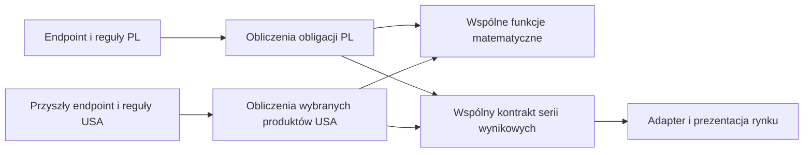

# Kalkulatory IKE i 800+ — architektura oraz implementacja

Data: 23.10.2026. Branch: `codex/ike-family-bond-options`.

Dokument uwzględnia końcową decyzję: osobne obliczenia i reguły dla rynków, wspólna matematyka tam, gdzie wzory są identyczne, oraz wspólny kontrakt wyników. Zastępuje propozycję uniwersalnego silnika konfigurowanego zestawem strategii.

## Zachowanie użytkowe

- W kalkulatorze obligacji checkbox uprawnienia do 800+ włącza ROS i ROD w ofercie, tabeli, obu wykresach i rankingu. Domyślnie jest wyłączony.
- Wszystkie trzy kalkulatory mają jedną opcję „Pomiń podatek Belki”. Nie ma osobnego przełącznika ani parametru IKE. Nazwa IKE występuje wyłącznie w treści wyjaśnień.
- Rozwijany opis wyjaśnia warunki zwolnienia, limity wpłat i pominięcie kosztów prowadzenia IKE. W obligacjach wskazuje również różnice w opłatach za wykup, reinwestowaniu i oprocentowaniu gotówki, bez przykładów.
- Pominięcie podatku nie zmienia dostępności obligacji rodzinnych ani pozostałych założeń symulacji. Tekst informuje, że ROS/ROD nie są dostępne w rzeczywistym IKE-Obligacje.
- Limit rodzinny pozostaje opisanym ograniczeniem, bez jego wyliczania.
- Wzory w metodologii oszczędzania na cel i regularnych wpłat są zapisane w natywnym MathML: osobne bloki, ułamki, potęgi i legenda symboli. Nie dodano bibliotek; wzory są obecne po prerenderze i mają opisy dla czytników ekranu.
- Stopka wskazuje rok 2026 i zawiera polską treść praw autorskich.
- Menu główne zawiera Kalkulatory, Poradniki i O nas. Na desktopie są to zwykłe linki; kalkulatory i poradniki korzystają ze wspólnego układu bocznego menu po lewej. Na telefonie Kalkulatory i Poradniki zachowują rozwijane podmenu, a wybór linku zamyka menu główne. Oba poradniki są również podlinkowane w stopce; linki stopki zawijają się na wąskim ekranie.
- W obligacjach pod nagłówkiem są formularz i wyniki; tabela oferty zakupu, założenia i metodologia znajdują się poniżej wyników oraz wykresów.

## Granice architektury



Obecne `treasury-bonds/bond-simulation.ts` pozostaje mechanizmem dla polskich produktów. Nie przebudowujemy go w tej zmianie. Wspólne funkcje matematyczne pozostają w `calculations/`. Konkretne funkcje wydzielamy dopiero wtedy, gdy drugi rynek potwierdzi ich przydatność.

Nowy rynek może mieć własny endpoint i własne DTO. Nie dziedziczy IKE ani 800+. Korzysta z kontraktu `contracts/bond-comparison.ts` i tych funkcji matematycznych, których założenia rzeczywiście odpowiadają jego instrumentom. Wspólny format nie wymusza wspólnej kolejności wszystkich naliczeń.

## Pliki i odpowiedzialności

| Miejsce | Odpowiedzialność |
| --- | --- |
| `functions/src/calculations/` | Istniejąca wspólna matematyka; bez zmiany wzorów |
| `functions/src/treasury-bonds/bond-simulation.ts` | Istniejące obliczenia PL; bez zmiany algorytmu |
| `functions/src/markets/pl/polish-calculator-options.ts` | Efektywne pominięcie podatku i dostępność polskich typów |
| `functions/src/contracts/bond-comparison.ts` | Typy transportowe serii, bez zależności od rynku i frameworków |
| `functions/src/treasury-bonds/treasury-bonds.ts` | Adapter nowego i starego kontraktu na obecne funkcje obliczeniowe |
| `calculators/shared/tax-options/` | Wspólna kontrolka pominięcia podatku dla trzech obecnych formularzy |
| `treasury-bonds/model/bond-comparison-adapter.ts` | Walidacja odpowiedzi i mapowanie do modelu widoku PL |
| `treasury-bonds/model/bond-presentation.ts` | Jeden katalog etykiet, kolorów i aktywnych typów |
| Komponenty formularzy i ich store | Preferencje, debounce, żądania, anulowanie i stan wyników |

Frontend importuje czyste kontrakty przez `@contracts/*` i reguły polskich opcji przez `@markets/pl/*`. Nie importuje Functions, Firebase ani algorytmu backendowego. Nie dodano pakietów workspace, bibliotek ani nowego frameworka.

## Preferencja podatku i dostępność obligacji

Obliczenia korzystają wyłącznie z `skipTax`. Formularz obligacji pokazuje pięć standardowych typów oraz ROS/ROD po zaznaczeniu uprawnienia rodzinnego, niezależnie od podatku. Wszystkie widoki korzystają z listy zaakceptowanej w odpowiedzi API.

Stare opcje produktu i ich migracje zostały usunięte. Nie ma ścieżki obliczeniowej IKE. Backend wylicza opisany scenariusz obligacji z podatkiem lub bez.

## Kontrakt API

Brak `contractVersion` zachowuje odpowiedź legacy: `data.values`, siedem typów, `calculationVersion: 2` i dotychczasowe kwoty. Nowy formularz wysyła `contractVersion=3`. Oba kontrakty używają istniejących funkcji obliczeń, bez kopii matematyki.

Nowa odpowiedź zawiera:

```ts
interface BondComparisonResponse {
  contractVersion: 3;
  calculationVersion: number;
  offerVersion: string;
  marketId: string;
  skipTax: boolean;
  series: {
    instrumentId: string;
    currency: string;
    points: { month: number; value: number }[];
  }[];
  benchmark: { month: number; value: number }[];
}
```

Lista instrumentów nie jest globalnym enumem polskich symboli. Każdy rynek ma własny katalog. Nie porównujemy kwot różnych walut bez osobnego modelu przeliczenia FX.

Adapter frontendowy PL sprawdza Zod: wersję kontraktu, silnika i oferty, rynek, walutę, skończone wartości oraz pełny, uporządkowany harmonogram. Sprawdza też zgodność listy typów i podatku ze złożonym żądaniem. Brak kwoty lub serii jest błędem, a nie zerowym wynikiem. Wewnętrzny model polskich widoków zachowuje dotychczasowe rekordy z opcjonalnymi ROS/ROD i listą aktywnych typów; nie zmuszamy innych rynków do jego używania.

## Zapis ustawień i asynchroniczność

- Obligacje zapisują wersję 4. Pozostałe formularze używają koperty `schemaVersion: 1` z `values`, obejmującej kapitał początkowy. Starszy, niekompletny lub niepoprawny zapis przywraca stan domyślny.
- Kalkulatory celu i regularnych wpłat zachowują poprzedni wynik podczas oczekiwania z widoczną etykietą i komunikatem „Przeliczanie…”. Edycja od razu anuluje stare żądanie, jeszcze przed debounce. Błąd ma przycisk ponowienia. Niepoprawne dane usuwają wyniki.
- Artykuły mają stan ładowania i błędu oraz ponowienie. Zmiana sluga usuwa poprzednią treść i anuluje poprzednie żądanie.

## Historyczna weryfikacja implementacji z 23.10.2026

Aktualną weryfikację zmian opisuje `docs/REVIEW-WDROZENIE-2026-10-24.md`. Poniższe wyniki dotyczą wcześniejszej wersji.

- 145 testów backendu: niezależne przykłady finansowe, zgodność legacy, nowy kontrakt i wszystkie kombinacje IKE/800+.
- 102 testy frontendu: preferencje, migracja, kontrolki, odpowiedzi API, wszystkie widoki/ranking oraz anulowanie nieaktualnej odpowiedzi przy zmianie scenariusza.
- 14/14 celowych mutacji kodu wykrytych; raport w `docs/baseline/calculator-mutations.json`.
- Weryfikacja HTTP na emulatorze: stare kontrakty, CORS i nowy kontrakt obligacji z czterema kombinacjami IKE/800+.
- Ręczna kontrola w przeglądarce lokalnej: trzy kalkulatory, wymuszenie podatku, przywrócenie preferencji i filtrowanie rodzinnych. Podgląd obligacji: `docs/baseline/ike-bonds-preview.jpg`; połączonej opcji i spójnych checkboxów: `docs/baseline/calculator-checkboxes-preview.jpg`.
- Przeszły lint obu części, build produkcyjny i kontrola treści po prerenderze. Łącznie przeszło 247 testów (145 backendu i 102 frontendu).
- Dodatkowo sprawdzono wygenerowane przestrzenie nazw MathML, strukturę ułamków i rok 2026 w HTML. Podgląd wzorów: `docs/baseline/calculator-formulas-preview.jpg`.

Kolejność przyszłego wdrożenia: Functions obsługujące oba kontrakty, następnie Hosting z nowym klientem. Publikacja wymaga osobnego polecenia użytkownika; zostało udzielone po końcowych poprawkach interfejsu.

## Publiczne adresy po polsku

| Stara ścieżka | Docelowa ścieżka |
| --- | --- |
| `/calculators` | `/kalkulatory/obligacje-skarbowe` |
| `/calculators/treasury-bonds` | `/kalkulatory/obligacje-skarbowe` |
| `/calculators/regular-contribution` | `/kalkulatory/regularne-oszczedzanie` |
| `/calculators/long-term-savings` | `/kalkulatory/oszczedzanie-na-cel` |
| `/about-us` | `/o-nas` |

Hosting zwraca bezpośrednie 301 dla starych adresów, również z końcowym ukośnikiem. Router Angulara obsługuje te same historyczne linki przy nawigacji wewnątrz aplikacji, zachowując query i fragment. Nie przekierowujemy nieznanych starych podstron do przypadkowego kalkulatora.

Zmienione są linki w całym interfejsie i Markdown artykułów, canonicale, dane strukturalne, sitemap, prerender oraz adresy grafik social. Klucze zapisanych ustawień i adresy API pozostają zgodne z dotychczasowymi klientami. Przed Hostingiem należy opublikować zmienione treści funkcji artykułów.
