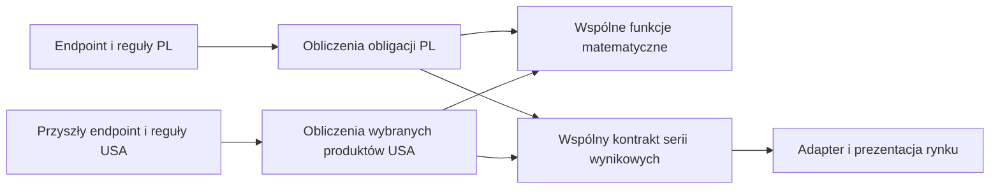

# Kalkulatory IKE i 800+ — architektura oraz implementacja

Data: 23.10.2026. Branch: `codex/ike-family-bond-options`.

Dokument uwzględnia końcową decyzję: osobne obliczenia i reguły dla rynków, wspólna matematyka tam, gdzie wzory są identyczne, oraz wspólny kontrakt wyników. Zastępuje propozycję uniwersalnego silnika konfigurowanego zestawem strategii.

## Zachowanie użytkowe

- W kalkulatorze obligacji checkbox uprawnienia do 800+ włącza ROS i ROD w ofercie, tabeli, obu wykresach i rankingu. Domyślnie jest wyłączony.
- W kalkulatorach oszczędzania na cel i regularnych wpłat jest jeden checkbox „Pomiń podatek Belki / symuluj IKE”. Nie ma osobnej opcji IKE.
- W obligacjach IKE wymusza brak podatku. Ręczna kontrolka podatku jest wtedy zaznaczona i zablokowana, a jej poprzednia preferencja zachowana. Wyłączenie IKE przywraca wcześniejszą preferencję podatku i uprawnienie rodzinne.
- Wszystkie opcje logiczne formularzy mają ten sam styl checkboxa; pominięcie inflacji i stopy zwrotu nie używa już stylu toggle.
- W IKE-Obligacje ROS i ROD nie występują w porównaniu. Pole uprawnienia rodzinnego jest zablokowane z wyjaśnieniem.
- IKE nie zmienia opłat wykupu, wzorów, reinwestowania ani oprocentowania wypłaconej gotówki. Nie zbieramy daty otwarcia, wieku, historii ani wpłat; nie sprawdzamy limitów lub warunków zwolnienia. Opis kontrolki obligacji brzmi: „Po zaznaczeniu IKE kalkulator nie nalicza podatku Belki.”
- Limit rodzinny pozostaje opisanym ograniczeniem, bez jego wyliczania.
- Wzory w metodologii oszczędzania na cel i regularnych wpłat są zapisane w natywnym MathML: osobne bloki, ułamki, potęgi i legenda symboli. Nie dodano bibliotek; wzory są obecne po prerenderze i mają opisy dla czytników ekranu.
- Stopka wskazuje rok 2026.

## Granice architektury



Obecne `treasury-bonds/bond-simulation.ts` pozostaje mechanizmem dla polskich produktów. Nie przebudowujemy go w tej zmianie. Wspólne funkcje matematyczne pozostają w `calculations/`. Konkretne funkcje wydzielamy dopiero wtedy, gdy drugi rynek potwierdzi ich przydatność.

Nowy rynek może mieć własny endpoint i własne DTO. Nie dziedziczy IKE ani 800+. Korzysta z kontraktu `contracts/bond-comparison.ts` i tych funkcji matematycznych, których założenia rzeczywiście odpowiadają jego instrumentom. Wspólny format nie wymusza wspólnej kolejności wszystkich naliczeń.

## Pliki i odpowiedzialności

| Miejsce | Odpowiedzialność |
| --- | --- |
| `functions/src/calculations/` | Istniejąca wspólna matematyka; bez zmiany wzorów |
| `functions/src/treasury-bonds/bond-simulation.ts` | Istniejące obliczenia PL; bez zmiany algorytmu |
| `functions/src/markets/pl/polish-calculator-options.ts` | Efektywne pominięcie podatku i dostępność polskich typów |
| `functions/src/contracts/bond-comparison.ts` | Typy transportowe serii, bez zależności od rynku i frameworków |
| `functions/src/treasury-bonds/treasury-bonds.ts` | Adapter nowego i starego kontraktu na obecne funkcje obliczeniowe |
| `calculators/shared/tax-options/` | Wspólna kontrolka IKE/podatek dla trzech obecnych formularzy |
| `treasury-bonds/model/bond-comparison-adapter.ts` | Walidacja odpowiedzi i mapowanie do modelu widoku PL |
| `treasury-bonds/model/bond-presentation.ts` | Jeden katalog etykiet, kolorów i aktywnych typów |
| Komponenty formularzy i ich store | Preferencje, debounce, żądania, anulowanie i stan wyników |

Frontend importuje czyste kontrakty przez `@contracts/*` i reguły polskich opcji przez `@markets/pl/*`. Nie importuje Functions, Firebase ani algorytmu backendowego. Nie dodano pakietów workspace, bibliotek ani nowego frameworka.

## IKE i preferencja podatku

Stan formularza obligacji zachowuje `skipTax` jako ręczną preferencję oraz `ike` jako osobne ustawienie:

```ts
const skipTax = options.skipTax || options.ike === true;
```

Formularz emituje efektywne ustawienie do obliczeń, zapisując do localStorage ręczną preferencję. Backend również stosuje tę regułę: `ike=true, skipTax=false` nadal oznacza brak podatku. Dzięki temu zachowanie nie zależy od interfejsu przeglądarkowego.

W kalkulatorach ogólnych formularze zapisują i wysyłają tylko `skipTax`. Odczyt wcześniejszego zapisu scala `skipTax || ike === true` w jedną preferencję, a kolejny zapis usuwa pole `ike`. Wyłączenie wspólnego checkboxa ponownie włącza podatek, także po odświeżeniu. Opcjonalne `ike` pozostaje obsługiwane przez API dla zgodności ze starszym klientem. Stare zapytania i formaty odpowiedzi zachowują dotychczasowe zachowanie.

## Dostępność obligacji

| IKE | Uprawnienie rodzinne | Nowe porównanie PL |
| --- | --- | --- |
| nie | nie | ROR, DOR, TOS, COI, EDO |
| nie | tak | ROR, DOR, TOS, COI, EDO, ROS, ROD |
| tak | nie | ROR, DOR, TOS, COI, EDO |
| tak | tak | ROR, DOR, TOS, COI, EDO |

Backend wybiera typy przed obliczeniami. Wszystkie widoki mają tę samą listę aktywnych typów z zaakceptowanej odpowiedzi. Nawet jeżeli model testowy zawiera wyższe kwoty ukrytego produktu, nie uczestniczą one w rankingu. Kolory tabeli są dobierane względem rzeczywiście porównywanych pozycji.

## Kontrakt API

Brak `contractVersion` zachowuje odpowiedź legacy: `data.values`, siedem typów, `calculationVersion: 2` i dotychczasowe kwoty. Nowy formularz wysyła `contractVersion=3`. Oba kontrakty używają istniejących funkcji obliczeń, bez kopii matematyki.

Nowa odpowiedź zawiera:

```ts
interface BondComparisonResponse {
  contractVersion: 3;
  calculationVersion: number;
  offerVersion: string;
  marketId: string;
  skipTax: boolean;
  series: {
    instrumentId: string;
    currency: string;
    points: { month: number; value: number }[];
  }[];
  benchmark: { month: number; value: number }[];
}
```

Lista instrumentów nie jest globalnym enumem polskich symboli. Każdy rynek ma własny katalog. Nie porównujemy kwot różnych walut bez osobnego modelu przeliczenia FX.

Adapter frontendowy PL sprawdza Zod: wersję kontraktu, silnika i oferty, rynek, walutę, skończone wartości oraz pełny, uporządkowany harmonogram. Sprawdza też zgodność listy typów i podatku ze złożonym żądaniem. Brak kwoty lub serii jest błędem, a nie zerowym wynikiem. Wewnętrzny model polskich widoków zachowuje dotychczasowe rekordy z opcjonalnymi ROS/ROD i listą aktywnych typów; nie zmuszamy innych rynków do jego używania.

## Zapis ustawień i asynchroniczność

- Obligacje zapisują `schemaVersion: 3`. Czytnik przyjmuje starszy płaski zapis i wersję 2, zachowując poprawne wartości. Nowe opcje domyślnie są wyłączone. Reset nadal jest świadomą akcją.
- Dwa pozostałe formularze przyjmują stary zapis bez `ike` oraz zapis z osobnym `ike`; oba trafiają do wspólnego pola `skipTax`. Nie zmieniamy kluczy localStorage i nie synchronizujemy scenariuszy między kalkulatorami.
- Zmiana kwoty zachowuje poprzedni zaakceptowany wynik podczas oczekiwania. Zmiana IKE, podatku lub dostępności rodzinnej natychmiast czyści poprzedni wynik i anuluje stare żądanie. Niepoprawny formularz także anuluje aktualne obliczenia.
- Zachowano debounce 300 ms i `switchMap`. Błąd obliczeń jest widoczny w każdym kalkulatorze. Odpowiedź anulowanego scenariusza nie może przywrócić nieaktualnego wyniku.

## Weryfikacja implementacji

- 145 testów backendu: niezależne przykłady finansowe, zgodność legacy, nowy kontrakt i wszystkie kombinacje IKE/800+.
- 94 testy frontendu: preferencje, migracja, kontrolki, odpowiedzi API, wszystkie widoki/ranking oraz anulowanie nieaktualnej odpowiedzi przy zmianie scenariusza.
- 14/14 celowych mutacji kodu wykrytych; raport w `docs/baseline/calculator-mutations.json`.
- Weryfikacja HTTP na emulatorze: stare kontrakty, CORS i nowy kontrakt obligacji z czterema kombinacjami IKE/800+.
- Ręczna kontrola w przeglądarce lokalnej: trzy kalkulatory, wymuszenie podatku, przywrócenie preferencji i filtrowanie rodzinnych. Podgląd obligacji: `docs/baseline/ike-bonds-preview.jpg`; połączonej opcji i spójnych checkboxów: `docs/baseline/calculator-checkboxes-preview.jpg`.
- Przeszły lint obu części, build produkcyjny i kontrola treści po prerenderze. Łącznie przeszło 239 testów (145 backendu i 94 frontendu).
- Dodatkowo sprawdzono wygenerowane przestrzenie nazw MathML, strukturę ułamków i rok 2026 w HTML. Podgląd wzorów: `docs/baseline/calculator-formulas-preview.jpg`.

Kolejność przyszłego wdrożenia: Functions obsługujące oba kontrakty, następnie Hosting z nowym klientem. Publikacja wymaga osobnego polecenia użytkownika; zostało udzielone po końcowych poprawkach interfejsu.
