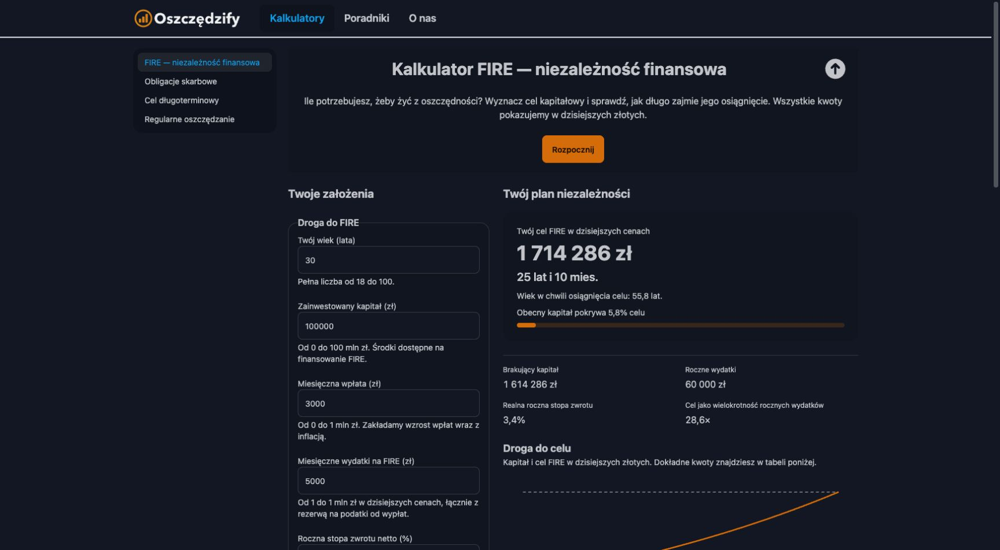

# Publikacja FIRE — 26.10.2026

- Adres: https://oszczedzify.org/kalkulatory/fire
- Gałąź: `codex/fire-calculator`.
- Commit źródeł: `46e94add74431e4e3bb3a15fd06267f9da580fea`.
- Build: `46e94ad-2026-10-26T16:11:25.626Z`, dirty: `False`.
- Hosting version: `61b98e7db6ef6288`.
- Release: `1793031145966000`, czas UTC: `2026-10-26T16:12:25.966Z`.
- Wdrożono tylko Hosting przypiętym CLI 15.34.1 z weryfikacją TLS.

## Weryfikacja

131/131 testów, lint, produkcyjny build, check:content oraz lokalny i produkcyjny smoke:hosting przeszły. Metadane publicznego version.json są bajtowo zgodne z artefaktem. Sprawdzono HTTP 200 nowej trasy, SEO, canonical, JSON-LD, sitemap, cache, przekierowania i rzeczywiste 404.

Przeglądarka: działający wynik domyślny (cel 1 714 286 zł; 25 lat i 10 miesięcy), zmiana wydatków na 4 000 zł aktualizuje czas do 21 lat i 11 miesięcy, reset przywraca przykład. Lokalnie sprawdzono walidację i szerokość 390 px bez elementów wychodzących poza obszar dokumentu.

Podczas publikacji karta otwarta przed wydaniem miała starą odpowiedź 404 i odwołanie do starego chunka; po odświeżeniu i przejściu z nowej strony głównej kalkulator działał poprawnie.

Punkt rollbacku: Hosting version `89ccf29bb2e79282`, release `1793030409551000`. Plan i opis modelu: [PLAN-I-WERYFIKACJA.md](PLAN-I-WERYFIKACJA.md).

