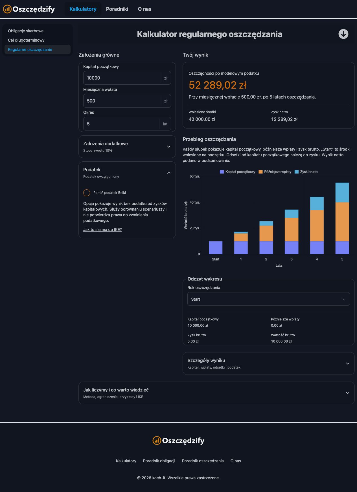
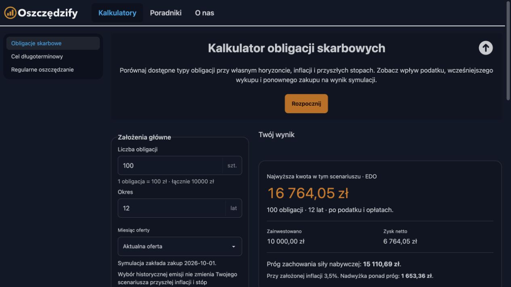
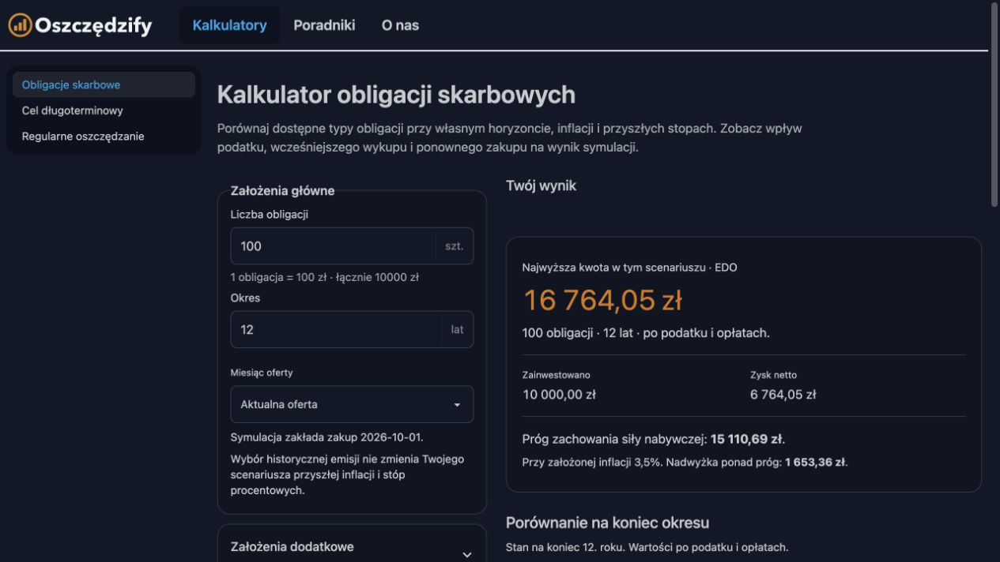

# Publikacja UI kalkulatorów — 26.10.2026

Na polecenie użytkownika wdrożono wyłącznie Firebase Hosting projektu `personal-finance-2ee61` z brancha `codex/calculators-ux-review`. PR #3 pozostaje osobnym krokiem przeglądu; publikacja nie scala brancha.

## Aktualizacja: słupki oszczędzania, nawigacja i wyrównanie

Na kolejne polecenie użytkownika opublikowano skumulowane słupki kapitału początkowego, wpłat i zysku, wspólny stan hero podczas zmiany kalkulatorów oraz wyrównane nagłówki i karty bez pustego miejsca nad wynikiem.

- Commit źródeł: `6b6c11edafb24fecc84cf41e0fdf99d26af19d0e`.
- Build: `6b6c11e-2026-10-26T15:49:42.293Z`, `dirty: false`, API production.
- Hosting version: `2ba4aae874dc5928`, release `1793029813862000`.
- Publikacja: 26.10.2026, 16:50:13 Europe/Warsaw (15:50:13 UTC).
- Punkt rollbacku: version `1743b743273c66f9`, release `1793009177969000`.
- Świeży produkcyjny build, prerender ośmiu tras, check:content i produkcyjny smoke:hosting przeszły. Publiczne version.json i app-check.json są identyczne z lokalnym artefaktem. Przed publikacją poprawki przeszły 123/123 testy frontendowe i lint.
- W przeglądarce potwierdzono wyrównanie nagłówków obligacji (obie pozycje 324 px) i zerową wysokość pustego komunikatu statusu. „Rozpocznij” zwija hero; przejścia obligacje → regularne oszczędzanie → cel zachowują zwinięcie.
- Produkcyjne API zwróciło wyniki wszystkich trzech kalkulatorów. Dla przykładowych 10 000 zł na start i 500 zł miesięcznie przez pięć lat przy 10% wykres regularnego oszczędzania pokazuje trzy warstwy, a odczyt „Start” zwraca sam kapitał 10 000 zł bez wpłat i zysku. Sprawdzono też cel pokryty kapitałem początkowym. W tej sesji brak błędów konsoli.
- Publikowano wyłącznie Hosting, przypiętym CLI 15.34.1 z włączoną weryfikacją TLS. Backend i App Check pozostają bez zmian. PR #3 nie został scalony.

## Aktualizacja: przywrócenie hero

Na kolejne polecenie użytkownika opublikowano poprawkę przywracającą przycisk „Rozpocznij”, zwijanie opisu hero i przewijanie do głównych założeń we wszystkich trzech kalkulatorach.

- Commit: `cd769fb5ba4c975d6f53871e1c9096d573ed3df4`.
- Build: `cd769fb-2026-10-26T10:05:40.274Z`, `dirty: false`, API production.
- Hosting version: `1743b743273c66f9`, release `1793009177969000`.
- Publikacja: 26.10.2026, 11:06:17 Europe/Warsaw (10:06:17 UTC).
- Punkt rollbacku: version `3f15af39c14e173a`, release `1793005987092000`.
- Świeży build, prerender, check:content i produkcyjny smoke:hosting przeszły; publiczny version.json jest identyczny z lokalnym artefaktem. Przed wdrożeniem poprawka przeszła 120 testów i lint.
- W rzeczywistej przeglądarce potwierdzono kliknięcie „Rozpocznij” na każdej z trzech stron: `aria-expanded=false`, a formularz po przewinięciu zaczyna się 64 px od góry, pod nagłówkiem aplikacji. Brak błędów konsoli w sprawdzonej sesji.
- Publikowano tylko Hosting, przypiętym CLI 15.34.1, z włączoną weryfikacją TLS. Backend i App Check pozostawiono bez zmian.

## Pierwsza publikacja UI

## Opublikowany artefakt

- Commit źródeł: `a872f0ad726221bcad89bb2df2dc6ccfda1279bf`.
- Build: `a872f0a-2026-10-26T09:11:52.610Z`, `dirty: false`, API `production`.
- Hosting version: `3f15af39c14e173a`.
- Release: `1793005987092000`, 26.10.2026 o 10:13:07 Europe/Warsaw (09:13:07 UTC).
- Adres: https://oszczedzify.org/kalkulatory/obligacje-skarbowe.
- Opublikowano dokładnie przygotowany i sprawdzony build; pomiędzy odbiorem a publikacją nie przebudowywano artefaktu.

Konektor Firebase zakończył próbę przed publikacją błędem rozpoznania domyślnego targetu Hostingu. Skuteczny deploy wykonano istniejącym, przypiętym CLI `firebase-tools@15.34.1`, z jawnym `--only hosting --project personal-finance-2ee61`. Komenda zakończyła się `Deploy complete`. Weryfikacja TLS była włączona.

Nie wdrażano Functions i nie zmieniano konfiguracji produkcyjnego App Check, Firestore ani ofert. `app-check.json` jest identyczny z plikiem lokalnym, w trybie `enforce`.

## Kontrola po wdrożeniu

- Świeży build produkcyjny z prerenderem oraz `check:content` przeszły.
- Publiczny `version.json` jest bajtowo identyczny z lokalnym artefaktem i wskazuje powyższy czysty commit.
- `smoke:hosting` przeszedł: strony i metadane, canonicale, JSON-LD, cache zasobów, no-store metadanych wydania, przekierowania 301, rzeczywiste 404, robots i sitemap.
- W rzeczywistej przeglądarce na produkcji sprawdzono trzy kalkulatory z działającym API: obligacje (EDO 16 764,05 zł dla widocznego scenariusza), regularne oszczędzanie (369 920,98 zł dla 1 000 zł miesięcznie przez 15 lat) oraz cel pokryty kapitałem początkowym (wymagana wpłata 0 zł). To potwierdzenie działania interfejsu i API dla tych scenariuszy, nie pełna regresja wszystkich kombinacji.
- Sprawdzono wykresy i widok mobilny 390 px; brak poziomego overflow strony. W sprawdzonej sesji konsola nie zgłaszała błędów.
- Produkcyjny odpowiednik testu `smoke-app-check.mjs` potwierdził dla wszystkich ośmiu endpointów: HTTP 401 dla braku i fałszywego tokenu, `Cache-Control: no-store`, preflight OPTIONS 204 i dopuszczony nagłówek App Check.

## Punkt rollbacku

Przed publikacją zapisano bieżący kanał `live` oraz identyfikator produkcyjnego buildu.

- Poprzednia Hosting version: `554ea82fd9fc331a`.
- Poprzedni release: `1792992006691000`.
- Poprzedni frontend: commit `7cd14ce61531b518cff1588e98579376cd62cf7e`, build `7cd14ce-2026-10-26T05:19:39.122Z`.

W razie potrzeby można przywrócić tę wersję w historii wydań Firebase Hosting. Oba wydania zachowują włączony produkcyjny App Check; rollback frontendu nie wymaga zmiany backendu.
